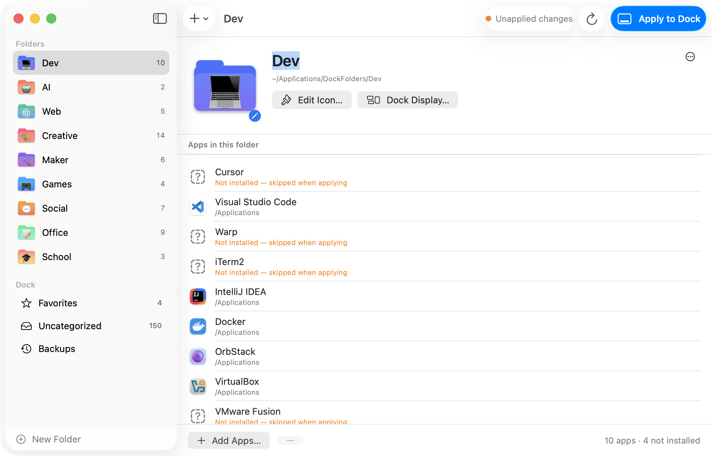
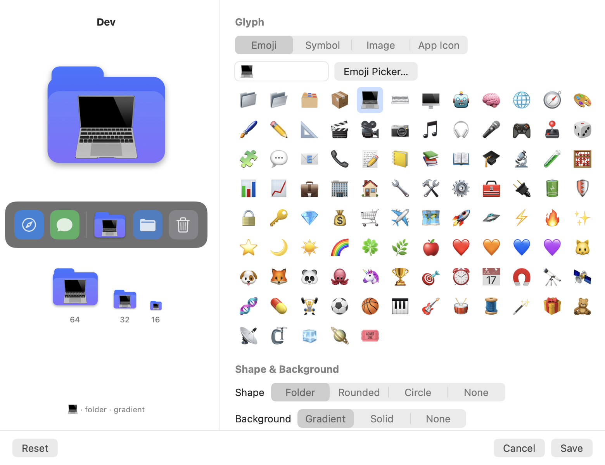

# 📁 DockFolders

> macOS Dock category organizer — native app with custom folder icons
> Organize your apps into categorized folders in the Dock. GUI or CLI.

   

<p align="center">
  
</p>

---

## 🇰🇷 한국어

### 무엇을 하는가?

맥 Dock에 흩어진 수십 개의 앱을 **카테고리 폴더**로 정리합니다. 각 폴더에는 **이모지 · SF Symbol · 직접 고른 이미지 · 앱 아이콘** 중 원하는 글리프와 색상·모양을 조합한 커스텀 아이콘을 씌울 수 있어요. 원본 앱은 건드리지 않고 **심볼릭 링크**만 만듭니다.

v2는 **네이티브 macOS 앱**입니다. Python, dockutil, fileicon 같은 외부 의존성이 전혀 없습니다.

### 설치

Xcode Command Line Tools만 있으면 됩니다 (`xcode-select --install`).

```bash
git clone https://github.com/geonhee15/dockfolders.git
cd dockfolders
./install.sh
```

설치하면 `/Applications/DockFolders.app`과 터미널 명령 `dockfolders`(`~/.local/bin`)가 생깁니다. v1의 `~/.config/dockfolders/config.sh`가 있으면 자동으로 가져옵니다.

### 사용법 (GUI)

1. **DockFolders** 앱을 엽니다. 처음이면 프리셋(개발자 · 크리에이터 · 학생 · 미니멀)을 고르거나 빈 상태로 시작합니다.
2. 사이드바에서 폴더를 고르고 **앱 추가…** 로 앱을 넣습니다. Finder나 '미분류' 목록에서 드래그해도 됩니다.
3. 큰 아이콘을 클릭해 **아이콘 편집기**를 엽니다. 글리프, 모양(폴더 · 둥근 사각형 · 원 · 없음), 그라데이션/단색 배경, 크기, 그림자를 바꿀 수 있어요.
4. **Dock에 적용** (⌘R)을 누릅니다. Dock 백업 → 폴더 생성 → 아이콘 렌더링 → Dock 갱신이 한 번에 진행됩니다.

<p align="center">
  
</p>

### 사용법 (CLI)

```bash
dockfolders                     # GUI 열기
dockfolders preset developer    # 프리셋 적용
dockfolders apply               # Dock에 적용
dockfolders discover            # 어느 폴더에도 없는 앱 보기
dockfolders pinned              # Dock의 고정 앱과 설정 비교
dockfolders pinned --from-dock  # Dock의 고정 앱을 설정으로 가져오기
dockfolders reset               # 마지막 백업으로 Dock 복원
dockfolders remove              # Dock에서 폴더 빼기
dockfolders help
```

### 편의 기능

- **미분류 보기** — 설치돼 있지만 어느 폴더에도 없는 앱을 한눈에 보고 메뉴 한 번으로 폴더에 넣습니다.
- **적용 상태 배지** — 설정을 바꾸면 "적용 안 된 변경"으로 표시됩니다.
- **백업/복원** — 적용할 때마다 Dock 스냅샷을 저장하고, 앱 안에서 바로 되돌릴 수 있습니다.
- **기존 Dock 항목 보존** — 다운로드 폴더 등 직접 넣어둔 항목은 그대로 둡니다 (설정에서 변경 가능).
- **고정 앱** — Dock 왼쪽의 고정 앱 영역은 Dock을 그대로 따라갑니다. Dock에서 직접 끌어 바꾼 것은 자동으로 반영되고, 앱 안에서 순서와 구분선(스페이서)을 편집해 적용할 수도 있어요. 건드리지 않도록 끌 수도 있습니다.
- **폴더별 Dock 표시** — 격자/부채꼴/목록, 폴더/스택, 정렬 기준을 폴더마다 다르게 설정할 수 있습니다.
- **JSON 설정** — `~/.config/dockfolders/config.json`. 내보내기/가져오기 지원, v1 `config.sh` 가져오기 지원.
- **한국어 UI** — 시스템 언어가 한국어면 자동으로 한국어로 표시됩니다.

### 작동 원리

1. `~/Applications/DockFolders/<폴더>/` 안에 앱의 심볼릭 링크를 만듭니다.
2. 아이콘을 CoreGraphics로 16–1024px 멀티 해상도로 렌더링해 `NSWorkspace`로 폴더에 적용합니다.
3. `com.apple.dock` 환경설정에 폴더 타일(과 고정 앱)을 직접 써넣고 Dock을 재시작합니다.

---

## 🇺🇸 English

### What it does

Organizes your scattered Mac apps into **categorized folders** in the Dock. Every folder gets a **custom icon** — an emoji, an SF Symbol, your own image or an app's icon, on a folder/rounded/circle shape with a gradient or solid background. Originals are never touched; only **symlinks** are created.

v2 is a **native macOS app** (SwiftUI) with a built-in CLI. No Python, no dockutil, no fileicon.

### Install

Requires the Xcode Command Line Tools (`xcode-select --install`). No Xcode, no Homebrew.

```bash
git clone https://github.com/geonhee15/dockfolders.git
cd dockfolders
./install.sh
```

This builds and installs `/Applications/DockFolders.app` and a `dockfolders` command in `~/.local/bin`. An existing v1 `~/.config/dockfolders/config.sh` is imported automatically.

> Building from source is the recommended install: the app is ad-hoc signed, so a downloaded build would be blocked by Gatekeeper until you run `xattr -dr com.apple.quarantine DockFolders.app`.

### Using the app

1. Open **DockFolders**. On first launch pick a preset (Developer, Creator, Student, Minimal) or start empty.
2. Select a folder in the sidebar and add apps with **Add Apps…**, or drag apps in from the Finder or the **Uncategorized** list.
3. Click the big icon to open the **icon editor**: glyph (emoji / SF Symbol / image / app icon), shape (folder, rounded, circle, none), gradient or solid colors, size and shadow — with a live preview at Dock sizes.
4. Hit **Apply to Dock** (⌘R). DockFolders backs up the Dock, builds the folders, renders the icons and updates the Dock in one go.

### CLI

```bash
dockfolders                     # open the GUI
dockfolders preset developer    # load a preset
dockfolders apply               # build folders + icons, update the Dock
dockfolders discover            # list apps that are in no folder
dockfolders list                # show the config
dockfolders pinned              # compare the Dock's pinned apps with the config
dockfolders pinned --from-dock  # adopt the Dock's pinned apps into the config
dockfolders reset               # restore the Dock from the latest backup
dockfolders backups             # list Dock backups
dockfolders remove              # take the folders out of the Dock
dockfolders import config.sh    # import a v1 config
dockfolders render-icon Dev out.png 512
dockfolders help
```

### Features

- **Uncategorized view** — see every installed app that isn't in a folder yet and file it with one click, or drag it onto a folder.
- **Status badge** — the toolbar shows whether the Dock matches the config ("Unapplied changes").
- **Backups** — a Dock snapshot is taken before every change; restore any of them from the app.
- **Keeps your other Dock items** — Downloads and other tiles you added yourself stay (configurable).
- **Pinned apps** — the left-hand section of the Dock is mirrored: whatever you rearrange in the Dock itself is picked up automatically, and you can reorder apps and spacers in the app and apply. Or leave that section alone.
- **Per-folder Dock display** — grid/fan/list, folder/stack, sort order; globally or per folder.
- **JSON config** — `~/.config/dockfolders/config.json`, import/export, v1 `config.sh` importer.
- **Localized** — English and Korean.

### Configuration

Everything is editable in the app, but the file is plain JSON:

```jsonc
{
  "folders": [
    {
      "name": "Dev",
      "apps": ["Visual Studio Code", "Cursor", "Warp", "Docker"],
      "icon": {
        "source": "emoji", "emoji": "💻",
        "shape": "folder", "background": "gradient",
        "color1": "#3A7BFF", "color2": "#6C4DFF",
        "scale": 0.58, "shadow": true
      }
    }
  ],
  "favorites": ["Cursor", "Google Chrome", "<spacer>", "Claude"],
  "settings": {
    "foldersDirectory": "~/Applications/DockFolders",
    "backupDirectory": "~/.config/dockfolders/backups",
    "manageFavorites": true,
    "keepOtherDockItems": true, "numberPrefix": false
  }
}
```

App names match the bundle file name (`Visual Studio Code`), the localized display name, a bundle id, or an absolute path. Apps that aren't installed are skipped. `favorites` is the Dock's pinned section in order; `"<spacer>"` and `"<small-spacer>"` stand for the Dock's spacer tiles.

### How it works

1. Creates `~/Applications/DockFolders/<Folder>/` with symlinks to the apps (stale folders that only contain symlinks are cleaned up).
2. Renders each icon with CoreGraphics at 16–1024 px and applies it with `NSWorkspace.setIcon`.
3. Writes the folder tiles (and the pinned apps, unless turned off) straight into the `com.apple.dock` preferences and restarts the Dock.

### Building

```bash
scripts/build.sh            # release build → build/DockFolders.app
scripts/build.sh --debug    # fast unoptimised build
UNIVERSAL=1 scripts/build.sh
```

The build uses `swiftc` directly, so it only needs the Command Line Tools. A `Package.swift` is included for Xcode / SwiftPM users.

> If your Command Line Tools install complains about `redefinition of module 'SwiftBridging'`, a stale `usr/include/swift/module.modulemap` was left behind by an older version. The build script works around it automatically; the permanent fix is `sudo rm /Library/Developer/CommandLineTools/usr/include/swift/module.modulemap`.

### Uninstall

```bash
./uninstall.sh      # or: dockfolders remove --delete-folders && rm -rf /Applications/DockFolders.app
```

### v1 (shell version)

The original zsh script (dockutil + fileicon + Pillow) lives in [`legacy/`](legacy/).

---

MIT © [geonhee15](https://github.com/geonhee15)
